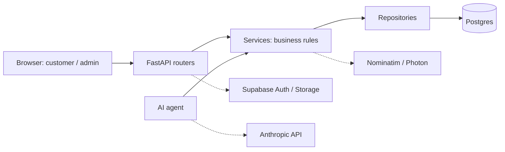

# CaterKing — AI catering platform

CaterKing is an ordering and management web app for **one catering business** that serves private events. Customers plan an event, pick dishes and get a server-calculated quantity and price, in Hebrew, Arabic or English (with right-to-left layout for he/ar). An AI assistant can answer questions and **propose** changes to the order, but nothing changes until the customer approves, and the owner approves or rejects every quote.

## Live links

| Environment | Customer | Owner (admin) |
|---|---|---|
| Production | https://caterking-9x51.onrender.com/customer/ | https://caterking-9x51.onrender.com/admin/ |
| Dev | https://caterking-dev.onrender.com/customer/ | https://caterking-dev.onrender.com/admin/ |

Both sites run on Render's free plan, which sleeps when idle: the first load after a pause can take about a minute.

## Features

**Customers** (no account needed)
- Plan an event: type, date, adults, children, vegetarian guests; pickup or delivery.
- Browse the menu in three languages, with per-category suggested quantities and a live server-side price.
- Send a quote request and follow it through a private link.
- Change the order until a cutoff before the event; it then returns to the owner for approval.

**Owner (admin, login required)**
- Manage categories, dishes (with images), allergens and dietary flags.
- Manage pickup slots, availability and per-category serving rules.
- Review every quote request: approve, reject, or cancel an order with a reason shown to the customer.
- Edit the business rules in the Settings tab.

**AI assistant**
- Reads the menu and the current order, answers questions, and proposes changes.
- A proposal applies only when the customer presses Approve. It cannot change prices, status or other data.
- Needs `ANTHROPIC_API_KEY`; without it the chat shows "unavailable" and everything else works.

**Business rules** (values are configurable in admin settings)
- Minimum notice before an event, and a minimum food total before a quote can be submitted.
- Delivery fee based on distance from the business (an estimate, confirmed by the owner).
- Warning when meat and dairy dishes are mixed; allergen disclaimer.
- Kashrut information is shown as information only, not as a certification.
- Changes allowed until a configurable number of hours before the event.

## Tech stack

| Layer | Technology |
|---|---|
| Backend | Python 3.12, FastAPI, Pydantic, SQLAlchemy 2 |
| Database | PostgreSQL 16 on Supabase |
| Auth and files | Supabase Auth (owner login), Supabase Storage (dish images) |
| Frontend | Vanilla HTML, CSS and JavaScript ES modules; no framework, no build step |
| AI | Claude Opus 5.5 through the Anthropic SDK |
| Geocoding | OpenStreetMap Nominatim, with Photon as a fallback |
| Hosting | Render (Docker, `render.yaml` blueprint) |
| Quality | pytest, Ruff, GitHub Actions |

## Architecture

One FastAPI app serves the JSON API and the static frontend from the same origin (so no CORS). Layers are strict: a layer only calls the one below it.



- **Backend is authoritative:** prices, quantities and order state are computed on the server; neither the frontend nor the model is trusted for them.
- **Agents call services only**, through typed tools, never the database directly.
- Details: [docs/ARCHITECTURE.md](docs/ARCHITECTURE.md) and [ADR 0003](docs/ADR/0003-backend-authoritative-pricing-and-proposals.md).

## Repository layout

```
backend/
  app/
    api/            routers (catalog, orders, admin, assistant, config)
    services/       business rules: pricing, quantities, delivery, geo, proposals
    repositories/   database queries
    models/         SQLAlchemy ORM models
    schemas/        Pydantic request/response models
    agents/         AI assistant: prompt, tools, tool loop
    core/           config, DB session, errors, auth, storage, rate limits
    main.py         app wiring, security headers, static mount
    migrate.py      applies pending SQL migrations
  tests/            pytest suite
frontend/
  customer/         customer app (HTML, JS, i18n)
  admin/            owner dashboard
  css/, js/         shared styles, fetch wrapper and DOM helpers
database/migrations/  plain SQL migrations (YYYYMMDDHHMMSS_name.sql)
docs/               specs, ADRs, deploy guide
scripts/smoke_api.sh  end-to-end smoke test against a running server
.github/workflows/    CI
Dockerfile          image used by Render (migrates, then runs uvicorn)
render.yaml         Render blueprint
.env.example        environment variable template
```

## Getting started locally

Prerequisites: [uv](https://docs.astral.sh/uv/) (installs a matching Python) and PostgreSQL 16.

```bash
cp .env.example .env                 # then fill in values; .env is git-ignored
createdb catering_dev && createdb catering_test
# in .env:
#   DATABASE_URL=postgresql+psycopg://localhost/catering_dev
#   TEST_DATABASE_URL=postgresql+psycopg://localhost/catering_test

cd backend
uv sync                              # install dependencies
uv run python -m app.migrate         # apply migrations (fresh database)
uv run uvicorn app.main:app --reload
```

Instead of `app.migrate` you can apply files by hand: `psql catering_dev -f database/migrations/<file>.sql`.

Open:
- Customer app: http://127.0.0.1:8000/customer/
- Owner dashboard: http://127.0.0.1:8000/admin/
- Health check: http://127.0.0.1:8000/health

The owner login uses Supabase Auth, so it needs `SUPABASE_URL`, `SUPABASE_ANON_KEY` and `SUPABASE_SERVICE_ROLE_KEY` in `.env`, an owner user with `app_metadata.role = "admin"`, and a public Storage bucket `dish-images`. Setup steps are in [docs/DEPLOY.md](docs/DEPLOY.md).

## Testing and quality

```bash
cd backend
uv run ruff check . && uv run ruff format --check .
uv run pytest
```

- `TEST_DATABASE_URL` must point to a database whose name ends in `_test`. The test fixture **drops and recreates the `public` schema** and re-applies all migrations.
- Tests fake Supabase, geocoding and the model; they need no network access.
- Smoke test against a running server (needs `curl` and `jq` and dev seed data): `scripts/smoke_api.sh [base_url]`.
- CI (GitHub Actions) runs Ruff and pytest against a Postgres 16 service on every push and pull request to `dev` and `main`.

## Deployment

- [`render.yaml`](render.yaml) defines two Docker web services: **caterking-dev** (branch `dev`) and **caterking** (branch `main`), both on the free plan today, both with auto-deploy and a `/health` check.
- Each environment has its own Supabase project (database, auth, storage).
- On start the container runs `python -m app.migrate`, which applies unapplied migrations once each.
- Secrets (`DATABASE_URL`, `SUPABASE_*`, `ANTHROPIC_API_KEY`) are `sync: false`: they are set only in the Render dashboard, never in git. `DATABASE_URL` must be Supabase's session-pooler string.
- Step-by-step guide: [docs/DEPLOY.md](docs/DEPLOY.md).

## Security and privacy

- **Guest orders** are reached only through a private link carrying a secret token.
- **Owner routes** require a Supabase JWT verified against the project's JWKS with `app_metadata.role == "admin"`.
- **Server-side pricing:** totals are never taken from the client.
- **AI can only propose:** proposals need customer approval; the model has no write access.
- **PII is never sent to the model:** name, contact details, address and owner notes are withheld.
- **Hardening:** Content-Security-Policy without inline scripts, `frame-ancestors 'none'`, `no-referrer`, per-IP rate limits, validated image uploads with a size cap.
- **Addresses stay out of URLs and logs:** delivery quotes are a POST.
- Never commit secrets; the Supabase service-role key stays server-side.

## Branching and contributing

- `main` is production; `dev` is the integration branch.
- Open feature branches as pull requests into `dev`; CI must pass.
- Releases are a pull request from `dev` to `main`.
- Business questions that are not decided yet are listed in [docs/OPEN_DECISIONS.md](docs/OPEN_DECISIONS.md); do not invent those rules.

## Documentation

| Document | Purpose |
|---|---|
| [docs/PRD.md](docs/PRD.md) | Product requirements |
| [docs/ARCHITECTURE.md](docs/ARCHITECTURE.md) | System design and layers |
| [docs/API_CONTRACTS.md](docs/API_CONTRACTS.md) | API endpoints and error shape |
| [docs/DATABASE_SCHEMA.md](docs/DATABASE_SCHEMA.md) | Tables, conventions, relationships |
| [docs/AI_AGENT_DESIGN.md](docs/AI_AGENT_DESIGN.md) | AI assistant scope, tools, safeguards |
| [docs/UX_UI_SPEC.md](docs/UX_UI_SPEC.md) | UX principles and screens |
| [docs/OPEN_DECISIONS.md](docs/OPEN_DECISIONS.md) | Open business questions and decision log |
| [docs/DEPLOY.md](docs/DEPLOY.md) | Supabase and Render setup |
| [ADR 0001](docs/ADR/0001-fastapi-monolith-static-frontend.md) | FastAPI monolith with static frontend |
| [ADR 0002](docs/ADR/0002-supabase-postgres-sqlalchemy.md) | Supabase Postgres via SQLAlchemy |
| [ADR 0003](docs/ADR/0003-backend-authoritative-pricing-and-proposals.md) | Server-side pricing, approval-gated AI |
| [ADR 0004](docs/ADR/0004-branching-and-environments.md) | Branches and environments |
| [ADR 0005](docs/ADR/0005-hosting-render-supabase.md) | Hosting on Render and Supabase |

Some specs still carry "draft" status headers from early phases; the code and [CLAUDE.md](CLAUDE.md) (guidance for AI coding agents) are the current reference.

## Project status

**Built:** phases 0 to 4 (specs, catalog and admin, customer ordering, business rules, AI assistant), a hardening pass, the cancel and edit-window features, and a UI redesign.

**Next:** a UX/UI round, real menu content, upgrading Render to the Starter plan (always on), and a custom domain.
